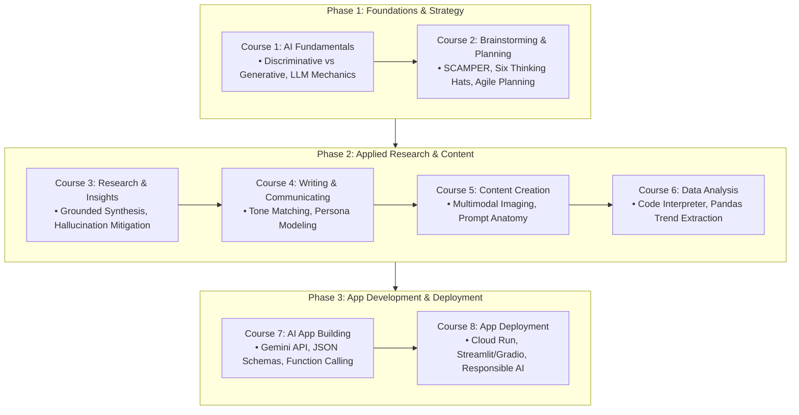

# 🤖 Google AI Professional Study Hub & Code Repository

<div align="center">

### **🏆 Official 8-Course Specialization — 100% Grade Perfection**

[](https://www.coursera.org/account/accomplishments/specialization/CA5GKQUP5NON)
[](https://ai.google.dev/)
[](https://python.org)

**Learner:** Eng. Ahmed Rifai  
**License:** Kiron Open Higher Education Coursera License  
**Comprehensive Study Guide:** [📖 Read the Complete Google AI Study Guide](STUDY_GUIDE.md)

</div>

---

## 📌 Repository Overview

This repository serves as an applied study hub, prompt engineering blueprint collection, and Gemini API code repository for the **Google AI Professional Certificate**. It documents production generative AI patterns across prompt frameworks (Chain-of-Thought, SCAMPER, persona modulation), multimodal image generation prompting, structured JSON schema generation, Gemini API function calling, and full-stack AI application deployment.

> [!NOTE]
> All binary credential certificates and verification proofs are officially archived in Google Drive and verified via official Coursera credential IDs. This repository focuses strictly on high-yield technical artifacts: structured coursework, reusable Python modules in `src/`, prompt engineering templates, and study guides.

---

## 🏗️ Google AI Curriculum Architecture



---

## 📚 Curriculum & Course Breakdown

| # | Course Title | Score | Focus Areas | Official Verification |
|:---:|:---|:---:|:---|:---:|
| **01** | AI Fundamentals | **100%** | Tokens, embeddings, temperature, safety filters, multimodal basics | [QI8IHDHHCN0Q](https://www.coursera.org/account/accomplishments/verify/QI8IHDHHCN0Q) |
| **02** | AI for Brainstorming and Planning | **100%** | SCAMPER, De Bono hats, agile milestone breakdowns, SWOT | [X5XL3NB2IO5Y](https://www.coursera.org/account/accomplishments/verify/X5XL3NB2IO5Y) |
| **03** | AI for Research and Insights | **100%** | Grounding, source synthesis, Chain-of-Verification, bias mitigation | [2EZMZXI6W1IO](https://www.coursera.org/account/accomplishments/verify/2EZMZXI6W1IO) |
| **04** | AI for Writing and Communicating | **100%** | Persona modulation, audience tailoring, executive briefs | [FYLTSG008C9N](https://www.coursera.org/account/accomplishments/verify/FYLTSG008C9N) |
| **05** | AI for Content Creation | **100%** | Multimodal prompt anatomy (Imagen), visual style descriptors | [B1JVAIY94GBX](https://www.coursera.org/account/accomplishments/verify/B1JVAIY94GBX) |
| **06** | AI for Data Analysis | **100%** | Automated code interpreter execution, pattern discovery | [21DW7SBNNBQU](https://www.coursera.org/account/accomplishments/verify/21DW7SBNNBQU) |
| **07** | AI for App Building | **100%** | Google Gemini API, structured JSON response schemas, function calling | [J8A9ZF2MWGXE](https://www.coursera.org/account/accomplishments/verify/J8A9ZF2MWGXE) |
| **08** | AI for App Deployment | **100%** | Streamlit/Gradio UIs, Cloud Run containerization, safety guardrails | [ZAIGRJ3EEW8M](https://www.coursera.org/account/accomplishments/verify/ZAIGRJ3EEW8M) |
| 🎓 | **Full Professional Certificate Credential** | **100%** | **Google AI Master Credential** | [CA5GKQUP5NON](https://www.coursera.org/account/accomplishments/specialization/CA5GKQUP5NON) |

---

## 📂 Repository Structure

```text
├── STUDY_GUIDE.md                     # Comprehensive theoretical & API study guide
├── README.md                          # Repository overview & verification index
├── .gitignore                         # Excludes cache, API keys & certificate binaries
├── src/
│   └── google_ai_toolkit/
│       ├── __init__.py                # Package initialization
│       ├── gemini_client.py           # Gemini API orchestrator & payload formatter
│       └── prompt_templates.py        # CoT, SCAMPER & few-shot prompt builders
├── 01_AI_Fundamentals/                # Course 1 Core Concepts
├── 02_AI_for_Brainstorming.../        # Course 2 Creative Prompt Frameworks
├── 03_AI_for_Research.../             # Course 3 Source Grounding & Insights
├── 04_AI_for_Writing.../              # Course 4 Persona Modeling & Communications
├── 05_AI_for_Content_Creation/        # Course 5 Multimodal Imaging Blueprints
├── 06_AI_for_Data_Analysis/           # Course 6 Python Data Interpretation
├── 07_AI_for_App_Building/            # Course 7 Gemini API & JSON Schemas
└── 08_AI_for_App_Deployment/          # Course 8 Cloud Deployment & Guardrails
```

---

## 🚀 Quickstart & AI Toolkit

### Installation
```bash
git clone https://github.com/Eng-Ahmed-Rifai/Google-AI-Professional-Certificate.git
cd Google-AI-Professional-Certificate
python -m venv .venv
source .venv/bin/activate  # On Windows: .venv\Scripts\activate
pip install google-generativeai pydantic
```

### 1. Generating Chain-of-Thought Reasoning Prompts
```python
from google_ai_toolkit.prompt_templates import build_cot_prompt

prompt = build_cot_prompt(
    task_instruction="Design an automated image crack classification pipeline for bridge inspections."
)
print(prompt)
```

### 2. Gemini API Client Formatting
```python
from google_ai_toolkit.gemini_client import GeminiOrchestrator

orchestrator = GeminiOrchestrator(model_name="gemini-1.5-flash")
payload = orchestrator.format_request_payload(
    prompt="Explain quantum entanglement to an 8th grader.",
    system_instruction="You are a compassionate physics teacher.",
    temperature=0.3
)
print(payload)
```

---

## 👤 Author
**Eng. Ahmed Rifai**  
*AI & Computer Vision Engineer*  
GitHub: [@Eng-Ahmed-Rifai](https://github.com/Eng-Ahmed-Rifai)
