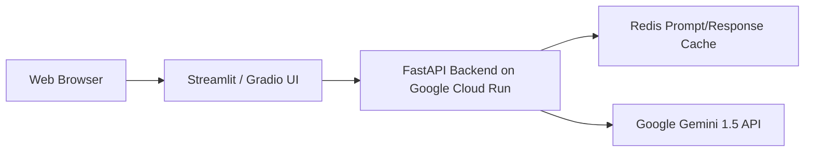

# 🤖 Google AI Professional Certificate — Comprehensive Study Guide

**Author:** Eng. Ahmed Rifai  
**Credential:** [CA5GKQUP5NON](https://www.coursera.org/account/accomplishments/specialization/CA5GKQUP5NON) (Verified 100% Mastery across all 8 Courses)  
**Target:** Generative AI Fundamentals, Prompt Engineering Blueprints, Multimodal Interaction, Gemini API Integration, and Full-Stack AI App Deployment.

---

## 📑 Table of Contents
1. [Course 1: AI Fundamentals](#course-1-ai-fundamentals)
2. [Course 2: AI for Brainstorming and Planning](#course-2-ai-for-brainstorming-and-planning)
3. [Course 3: AI for Research and Insights](#course-3-ai-for-research-and-insights)
4. [Course 4: AI for Writing and Communicating](#course-4-ai-for-writing-and-communicating)
5. [Course 5: AI for Content Creation (Multimodal Prompting)](#course-5-ai-for-content-creation)
6. [Course 6: AI for Data Analysis](#course-6-ai-for-data-analysis)
7. [Course 7: AI for App Building (Gemini API & Function Calling)](#course-7-ai-for-app-building)
8. [Course 8: AI for App Deployment & Responsible AI](#course-8-ai-for-app-deployment)

---

## Course 1: AI Fundamentals

### 1. Discriminative vs Generative AI
- **Discriminative AI**: Learns decision boundaries $P(Y \mid X)$ to classify or predict labels (e.g., spam vs ham, tumor classification).
- **Generative AI**: Learns data distributions $P(X)$ or conditional generation $P(X \mid Y)$ to generate novel text, images, code, or audio based on learned patterns.

### 2. Large Language Model Architecture & Hyperparameters
- **Tokens**: Fundamental computational units (~4 characters in English).
- **Embeddings**: High-dimensional vector representations capturing semantic relationships ($\cos(\theta) = \frac{\vec{u} \cdot \vec{v}}{\|\vec{u}\| \|\vec{v}\|}$).
- **Temperature ($T$)**: Controls probability distribution softness:
  $$P(w_i) = \frac{\exp(z_i / T)}{\sum_j \exp(z_j / T)}$$
  - Low $T$ ($0.0 - 0.2$): Deterministic, analytical, coding, structured JSON.
  - High $T$ ($0.7 - 1.0$): Diverse, creative writing, brainstorming.
- **Top-P (Nucleus Sampling)**: Dynamically selects the smallest subset of tokens whose cumulative probability exceeds threshold $p$.

---

## Course 2: AI for Brainstorming and Planning

### Creative Prompting Frameworks
- **SCAMPER**: Substitute, Combine, Adapt, Modify/Magnify, Put to other uses, Eliminate, Reverse.
- **Edward de Bono's Six Thinking Hats**:
  - White (Data & Facts), Red (Emotions & Intuition), Black (Risks & Cautions), Yellow (Benefits & Optimism), Green (Creative Alternatives), Blue (Process & Meta-management).
- **Agile Milestone Planning**: Prompting LLMs to break epic features into INVEST user stories (Independent, Negotiable, Valuable, Estimable, Small, Testable) with acceptance criteria.

---

## Course 3: AI for Research and Insights

### Grounding & Mitigation of Hallucinations
- **Grounded Generation**: Restricting the model's knowledge space strictly to provided context documents.
- **Chain-of-Verification (CoVe)**: Prompting the model to draft an answer, generate verification questions, answer them independently, and revise the final response.

---

## Course 4 & 5: Writing, Communicating & Content Creation

### 1. Persona Framing & Tone Modulation
- Establishing explicit persona context, target audience profile, reading level (e.g., 8th-grade vs executive C-suite), and formatting constraints (bulleted executive summary, email draft).

### 2. Multimodal Image Prompt Anatomy (Imagen / Midjourney)
- Formula: `[Subject Description] + [Artistic Medium / Style] + [Environment / Setting] + [Lighting & Color Palette] + [Camera Lens / Composition / Framing]`.

---

## Course 6: AI for Data Analysis

### Code Interpreter & Data Discovery
- Utilizing LLMs to write and execute Python code on tabular datasets (`pandas`, `numpy`).
- Prompting for automated anomaly detection, summary statistics generation, and generating Matplotlib/Seaborn charting scripts.

---

## Course 7: AI for App Building (Gemini API)

### 1. Structured JSON Output & Schemas
Enforcing deterministic output by providing response schemas:
```python
response = client.models.generate_content(
    model="gemini-1.5-pro",
    contents="Analyze the customer review...",
    config={
        "response_mime_type": "application/json",
        "response_schema": {
            "type": "OBJECT",
            "properties": {
                "sentiment": {"type": "STRING"},
                "confidence_score": {"type": "NUMBER"},
                "key_issues": {"type": "ARRAY", "items": {"type": "STRING"}},
            },
            "required": ["sentiment", "confidence_score"],
        },
    },
)
```

### 2. Function Calling (Tool Use)
- Defining function specifications with parameters. The model outputs a `tool_call` with arguments; the application executes the Python function locally and feeds results back to the model.

---

## Course 8: AI for App Deployment & Responsible AI

### 1. Deployment Architecture


### 2. Responsible AI Principles
- Enforcing Google Safety Filters: Harassment, Hate Speech, Sexually Explicit, Dangerous Content thresholds.
- Data Privacy: Ensuring enterprise confidentiality by opting out of training data usage.
